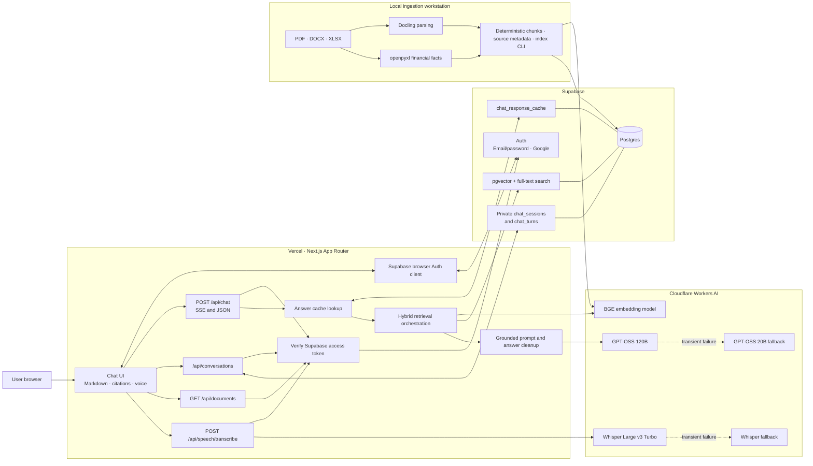
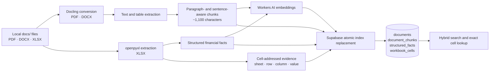

# Silverline Source-Grounded Assistant

A full-stack retrieval-augmented generation (RAG) application for asking questions about the **illustrative Silverline sample documents**. Answers are generated from retrieved evidence, include source citations, and are saved in private, authenticated chat sessions.

> **Important:** Silverline and the documents in `docs/` are fictional training samples. They are not real company information, approved records, filings, or professional advice.

## Contents

- [Architecture at a glance](#architecture-at-a-glance)
- [Technology stack](#technology-stack)
- [Request and data flows](#request-and-data-flows)
- [AI models](#ai-models)
- [Authentication and authorization](#authentication-and-authorization)
- [Database, retrieval, and cache](#database-retrieval-and-cache)
- [Document ingestion with Docling](#document-ingestion-with-docling)
- [Project structure](#project-structure)
- [Local development](#local-development)
- [Email and Google provider setup](#email-and-google-provider-setup)
- [Deployment and hosting](#deployment-and-hosting)
- [Environment variables](#environment-variables)
- [API overview](#api-overview)
- [Validation](#validation)
- [Operational notes](#operational-notes)

## Architecture at a glance

The web application runs on Vercel. Supabase provides Auth and Postgres; Cloudflare Workers AI provides model inference. Document parsing and indexing are an explicit local Python CLI task, not a deployed service.



### Major boundaries

| Layer | Responsibility | Runs on |
|---|---|---|
| Frontend | Authentication screens, chat sessions, streaming UI, Markdown, citations, document panel, voice recording | Browser, delivered by Vercel |
| Backend | Authenticated Next.js Route Handlers for chat, sessions, documents, and transcription | Vercel Node.js Functions |
| Identity | Persistent sign-up/sign-in with email/password or Google OAuth | Supabase Auth |
| Application data | User-owned sessions and turns, indexed documents, chunks, structured facts, answer cache | Supabase Postgres |
| Retrieval | Exact workbook-cell lookup for supported spreadsheet questions; vector similarity and PostgreSQL full-text matching for narrative evidence | Supabase Postgres with pgvector |
| Model inference | Embeddings, text generation, speech-to-text | Cloudflare Workers AI |
| Ingestion | Parse local files, make chunks/facts, request embeddings, atomically replace indexed document data | Local Python environment |

## Technology stack

- **Frontend and backend:** Next.js 15 App Router, React 19, TypeScript, Node.js Route Handlers.
- **UI:** React Markdown with GitHub Flavored Markdown support, Lucide icons, responsive CSS.
- **Authentication:** Supabase Auth using the Supabase JavaScript client. Supports email/password and Google OAuth.
- **Database:** Supabase-hosted PostgreSQL, `pgvector`, generated full-text search vectors, and SQL RPC functions.
- **Text generation:** Cloudflare Workers AI GPT-OSS models.
- **Embeddings:** Cloudflare Workers AI BGE base English model by default.
- **Speech-to-text:** Cloudflare Workers AI Whisper models. The browser records audio; transcription runs on the server.
- **Ingestion:** Python, Docling, openpyxl, and python-dotenv.
- **Hosting:** Vercel for the Next.js application; Supabase for Auth/Postgres; Cloudflare for AI inference.

## Request and data flows

### Chat and RAG

```mermaid
sequenceDiagram
    actor User
    participant Browser as Next.js chat UI
    participant API as Vercel /api/chat
    participant Auth as Supabase Auth
    participant Cache as Supabase answer cache
    participant AI as Cloudflare Workers AI
    participant DB as Supabase Postgres search
    participant History as Conversation API

    User->>Browser: Ask a document question
    Browser->>API: POST with Supabase bearer token
    API->>Auth: Verify access token
    Auth-->>API: Authenticated user
    API->>API: Apply greeting/courtesy/out-of-scope policy
    API->>API: Resolve intent and classify the question
    alt Reformat previous answer
        API->>AI: Reformat prior answer without new retrieval
        AI-->>Browser: Answer tokens
    else Information request
        alt Supported spreadsheet lookup
            API->>DB: Exact workbook-cell lookup
            DB-->>API: Matching cells with sheet/row/cell provenance
            API->>AI: Generate grounded answer (streaming)
            AI-->>Browser: Progress and answer-token events
            AI-->>API: Completed generation
        else Narrative search
            API->>AI: Embed question and focused query variants
            AI-->>API: Query vectors
            API->>Cache: Check eligible cache key
            alt Cache hit
                Cache-->>API: Cached response and citations
            else Cache miss
                API->>DB: Hybrid vector + full-text search
                DB-->>API: Ranked chunks/facts with provenance
                API->>API: Fuse and rerank candidates
                API->>AI: Generate grounded answer (streaming)
                AI-->>Browser: Progress and answer-token events
                AI-->>API: Completed generation
                API->>API: Repair source-verifiable split words and citations
                API->>Cache: Save eligible successful response
            end
        end
    end
    end
    API-->>Browser: Final answer, citations, abstention state
    Browser->>History: Save turn in the active session
    History->>Auth: Verify access token and session ownership
    History-->>Browser: Saved turn
    Browser-->>User: Render completed answer as Markdown
```

The `/api/chat` route returns ordinary JSON when requested without `Accept: text/event-stream`. The chat interface uses server-sent events (SSE) for progress and generated text. After generation, the final event carries the normalized answer and citations; the UI renders that completed answer as Markdown. Requests in an existing session include its session ID; the server loads the latest stored turns for that authenticated user and does not accept client-supplied history.

### Document ingestion



Parsing happens locally. In normal indexing mode, document text/facts and embeddings are sent to Supabase and Cloudflare for indexing. Original source files are not uploaded by the CLI.

## AI models

Model IDs are configurable through environment variables. Defaults are defined in `.env.example` and the provider implementation.

| Capability | Default model | Fallback | Provider |
|---|---|---|---|
| Text embeddings | `@cf/baai/bge-base-en-v1.5` (768 dimensions) | None configured | Cloudflare Workers AI |
| Chat and answer generation | `@cf/openai/gpt-oss-120b` | `@cf/openai/gpt-oss-20b` | Cloudflare Workers AI |
| Speech transcription | `@cf/openai/whisper-large-v3-turbo` | `@cf/openai/whisper` | Cloudflare Workers AI |

The fallback text model is used for eligible transient provider failures before text has been emitted. A truncated response may be continued for up to two additional generation passes. The transcription route limits uploads to 2 MB and validates the audio media type.

The text models are open-weight models served as hosted inference by Cloudflare; using them through Workers AI is not necessarily free. Check Cloudflare’s current [Workers AI pricing](https://developers.cloudflare.com/workers-ai/platform/pricing/) and account limits.

## Authentication and authorization

1. The browser signs up or signs in through Supabase Auth. Email/password and Google are supported.
2. Supabase persists the authentication session in the browser.
3. Authenticated frontend requests attach the Supabase access token as a bearer token.
4. The API verifies the token with Supabase Auth before handling chat, session, document-list, or transcription requests.
5. The server uses the Supabase service-role key for database operations only after verifying the user. Session queries and mutations are scoped to the authenticated user.
6. `chat_sessions` and `chat_turns` have row-level security policies that restrict authenticated database access to rows owned by the user.

The public Supabase URL and anon/publishable key are browser configuration, not secrets. **Never expose `SUPABASE_SERVICE_ROLE_KEY` or `CLOUDFLARE_API_TOKEN` in a `NEXT_PUBLIC_` variable.**

### Email and Google provider setup

- In Supabase **Authentication → Providers**, enable Email and Google as desired.
- To allow immediate email/password sign-in, turn off email confirmation in the Supabase Auth settings. If email confirmation is enabled, it takes precedence over the app’s behavior.
- Configure Google OAuth credentials in Supabase and Google Cloud. Use the callback URI shown by Supabase for the Google OAuth client.
- Set Supabase **Authentication → URL Configuration → Site URL** to the production Vercel deployment.
- Add the production domain, local development URL, and any preview origins used to Supabase’s **Redirect URLs** allowlist. Keep preview rules scoped to your own Vercel project.
- Email confirmation and Google OAuth return users to the app origin where sign-up/sign-in started.

## Database, retrieval, and cache

Apply all migrations under `supabase/migrations/` in filename order.

### Main tables

| Table | Purpose |
|---|---|
| `documents` | Indexed document metadata, filename, type, checksum, and indexing time |
| `document_chunks` | Extracted text chunks, source locations, metadata, and embeddings |
| `structured_facts` | Spreadsheet facts with metric, scope, period, unit, value, source location, and embeddings |
| `workbook_cells` | Exact spreadsheet cells with worksheet, coordinates, row/column labels, values, units, periods, and formula metadata |
| `chat_sessions` | User-owned chat sessions and display titles |
| `chat_turns` | User-owned questions, answers, citations, abstention state, and optional document scope |
| `chat_response_cache` | Successful answer payloads with corpus/configuration versions and expiration |
| `turn_feedback` | Per-user answer ratings, query/answer/source snapshots, query and source embeddings, and retrieval match estimate |

Retrieval has two main paths. For supported numeric and spreadsheet questions, the chat route classifies the request and calls `lookup_workbook_cells` against the indexed workbook cells. Lookup filters can use row labels, column headers, periods, scope, worksheet names, or explicit coordinates; an exact period header or “As at” date is preferred when the question names one. The matching cells, including their source locations, are provided as evidence for the answer. This path depends on the workbook having been extracted and indexed correctly.

Bare requests for a known workbook sheet (for example, “balance sheet” or “show me the balance sheet”) are routed to an exact sheet-name cell lookup, then summarized from the returned source cells with citations, rather than relying on semantic vector search to infer the worksheet.

When a question names an exact spreadsheet column header (for example, “Half year ended 30-Sep-2026”), that header is the authoritative period filter. The inferred shorthand (`H1`) is not also applied as a database filter, since it can match both current- and prior-year half-year columns. The returned cell is checked against the requested header before it is used to answer.

Explicit “As at” dates are handled the same way: the date is matched against the indexed column header, which avoids depending on derived period metadata for balance-sheet cell retrieval.

Other questions use hybrid retrieval over document chunks and structured facts. Supabase finds candidates using both vector similarity (question embeddings) and PostgreSQL full-text matching (question words), then combines the ranks with reciprocal-rank fusion. The application can add focused query variants for recognized question patterns; their results are fused with the original-query results. Candidates are then reranked using combined search scores and lexical overlap with the original question and source metadata. Feedback can influence ordering, but it does not replace search results or establish factual correctness.

If the user selected a document, narrative hybrid search and workbook lookup are restricted to that document. Bare requests for a known workbook sheet (for example, “balance sheet”) use an exact sheet-name cell lookup rather than depending on vector search to infer the worksheet. Retrieved evidence is sent to the grounded-answer step with its filename and source location for citations. Retrieval scores and the displayed evidence-match estimate indicate ranking relevance; neither is a verified probability that the answer is correct.

The default embeddings have **768 dimensions** to match the migration’s vector columns and search-function signatures. If you change the embedding model or dimensions, update the model configuration and database schema/functions consistently, then re-index the corpus.

### Answer feedback and retrieval quality

- Each completed answer offers thumbs-up/down feedback. Ratings and their associated question, answer, selected source passages, query embedding, and source embeddings are stored in `turn_feedback`.
- Apply `supabase/migrations/202610270003_turn_feedback_retrieval_quality.sql` before enabling feedback. The table is private to server-side service-role access; API routes verify the signed-in user and only search that user’s ratings.
- On each new question the app first compares its query embedding with that user’s rated questions from the same corpus revision and document scope. A close positive match boosts the previously helpful source IDs; a close negative match demotes those IDs. Normal hybrid retrieval still runs and supplies the evidence. The feedback match threshold defaults to `0.78` and can be set with `FEEDBACK_MATCH_MIN_SIMILARITY`.
- The displayed **evidence match estimate** is the mean score of the top five selected results, not a verified accuracy probability. The separate feedback approval percentage is the user’s positive ratings divided by all of their ratings, with the number of ratings shown.

### Answer cache

- Cache keys are based on normalized question text, the current corpus revision, and a configuration hash.
- `chat_response_cache` must have a composite primary key on `(question_key, corpus_revision, configuration_hash)` for Supabase upserts. The migration `202610270001_chat_response_cache_composite_key.sql` upgrades an existing cache table created with an older key and removes duplicate cache entries before enforcing the composite key.
- The corpus revision includes indexed document names, paths, and checksums. The config hash includes prompt/retrieval versions, model IDs, embedding dimensions, token limit, and relevance threshold.
- Cached answers expire after 24 hours by default (`CHAT_CACHE_TTL_SECONDS`).
- A prompt/model/corpus change produces a cache miss; cached answers are not user-specific because the indexed Silverline corpus is shared.
- Cache read/write errors are logged; the system can continue with fresh generation if cache access fails.

### Grounding and output quality

- The prompt instructs the model to use only retrieved evidence and cite factual claims.
- Answers preserve cited source labels and source locations; unsupported evidence results in an abstention rather than an invented answer.
- Generated word fragments are repaired only when the joined word exists in retrieved source text. Malformed citation labels are normalized before the final response is cached and returned.
- The UI shows plain text while streaming and renders the completed answer with React Markdown and GFM.
- A lightweight query policy returns distinct messages for greetings, courtesy messages, and clearly unrelated requests. Ambiguous terms and document headings are allowed through to retrieval.
- A conversation-intent layer distinguishes requests to reformat the immediately previous answer from information-seeking follow-ups. Reformatting preserves the previous answer's citations without retrieving or introducing new facts. Other questions retrieve using the current question plus recent user questions to resolve references, while the current retrieved sources remain the factual authority.

## Document ingestion with Docling

The CLI is under `ingestion/` and supports **PDF, DOCX, and XLSX**. It is not run during chat requests and is not deployed as part of the Vercel app.

### What the ingestion pipeline does

1. Recursively finds PDF, DOCX, and XLSX files under `docs/` (or the directory passed with `--docs-dir`). `--file` limits a run to one file.
2. Converts PDF and DOCX with Docling, extracting text and tables with available source locations. If Docling fails for a PDF during a folder run, the CLI retries that PDF using PDFium text extraction.
3. Groups extracted text into paragraph- and sentence-aware chunks targeting about 1,100 characters. Oversized paragraphs are split at sentence or word boundaries; chunks do not overlap.
4. Reads XLSX files with openpyxl to extract structured financial facts and populated worksheet cells. Cell records preserve sheet, cell address, row label, column header, and value for exact spreadsheet lookups.
5. Attaches deterministic, source-derived retrieval metadata such as filename, document type, section, and available page, table, or workbook location. A generative model does not rewrite or segment source evidence.
6. For a real indexing run, embeds chunks and structured facts with the configured Cloudflare embedding model, then sends embeddings, chunks, facts, workbook cells, document metadata, and the SHA-256 checksum to Supabase.
7. Calls the Supabase `replace_document_index_v2` RPC to atomically replace that document’s chunks, facts, and cells. The checksum is retained with document metadata and contributes to corpus revisioning.

Use `--dry-run` to parse files and print counts (and workbook sheet dispositions) without embeddings, credentials, or database writes. A successful dry run checks extraction and reporting; it does not verify the configured embedding service or Supabase upload.

Spreadsheet formulas using supported arithmetic, cell references, and `SUM` ranges are evaluated deterministically; the calculated result takes precedence over any cached formula value. Unsupported or unavailable formulas are reported as unavailable, never coerced to zero. Explicit “as at” dates in column headers take precedence over filename-level reporting periods, so balance-sheet dates are not mislabeled as quarter flows. Spreadsheet period and unit extraction handles fiscal quarter/half-year headings and declared sheet units where present.

Each workbook index stores a worksheet manifest in document metadata: sheet name/state, used dimensions, populated/numeric/formula cell counts, structured-fact count, and a disposition (`structured_facts`, `narrative_or_unstructured`, or `excluded_dashboard`). No sheet is silently discarded. `--dry-run` prints every sheet disposition and reports chunk/fact counts without embedding or writing to Supabase. The replace-index RPC inserts extracted records in set-based statements, preserving atomic replacement while avoiding per-row PL/pgSQL insert loops.

### Workbook extraction evaluation

The reviewed source-cell cases in `ingestion/tests/fixtures/workbook_numeric_gold.json` are a release gate for value text, numeric value, period, scope, unit, row label, and exact cell provenance. They include standalone/consolidated financial values and both current and comparative balance-sheet dates.

Run the workbook evaluator and Python regressions from the repository root in PowerShell:

```powershell
npm run validate:retrieval
```

`npm run test:ingestion` and `npm run evaluate:workbooks` are also available separately. The evaluator exits non-zero if any gold check fails; expected results are exact, not a similarity threshold. Add reviewed cases from each newly supported workbook/table shape before changing ingestion behavior. The TypeScript suite separately exercises query parsing, ambiguity/abstention, exact values, comparisons, follow-ups, and citations.

Chunk content is kept as extracted source evidence; section and location are preserved separately, and extracted terms are source-derived lexical hints. Spreadsheet formulas using supported arithmetic, references, and `SUM` ranges are evaluated deterministically; unsupported or unavailable formulas are reported rather than silently coerced to zero. For Excel workbooks, populated cells are indexed with their sheet, A1 address, row label, column-header path, value, unit, period, and formula metadata. Numeric lookups use this cell index rather than relying only on embedding similarity. Apply all migrations, including `supabase/migrations/202610260002_chunk_retrieval_metadata.sql` and migrations `202610280001` through `202610280004`, before indexing and deploying this version. Re-index workbooks after applying the cell-index migration so the new cell records are populated.

### Install and run ingestion on Windows

From the repository root in PowerShell:

```powershell
py -3 -m venv ingestion/.venv
ingestion/.venv/Scripts/python.exe -m pip install -r ingestion/requirements.txt
ingestion/.venv/Scripts/python.exe ingestion/indexer.py --docs-dir docs --dry-run
```

The npm evaluation scripts use the `python` executable on `PATH`; activate `ingestion/.venv` first if you prefer the project's pinned ingestion dependencies.

After reviewing the dry run, apply all migrations, including `202610280001_exact_structured_fact_lookup.sql`, `202610280002_bulk_document_index_replace.sql`, `202610280003_workbook_cell_index.sql`, and `202610280004_normalized_workbook_cell_lookup.sql`. The bulk writer migration replaces the row-by-row index writer and allows up to 60 seconds for the atomic database statement. The workbook-cell migration adds the cell-level index, direct coordinate lookup, and replacement RPC used by the current indexer; the normalized lookup migration makes row/header matching robust to punctuation in labels and dates. Then set the ingestion credentials in the repository-root `.env.local` (or the process environment) and index:

```powershell
ingestion/.venv/Scripts/python.exe ingestion/indexer.py --docs-dir docs
```

To retry a single failed document without re-embedding the rest of the corpus:

```powershell
ingestion/.venv/Scripts/python.exe ingestion/indexer.py --docs-dir docs --file docs/Silverline_Industries_Financial_Results_Q2_H1_FY2026-27.xlsx
```

The indexer loads `.env.local` from the repository root and does not override variables already set in the shell. Use `--docs-dir <path>` to index another local folder. Batch mode processes files in isolated workers so a native converter crash cannot stop later documents. If Docling fails for a PDF, the indexer retries text extraction with PDFium; this preserves page-level text but may not recover Docling's structured tables. Other failed files are reported by name, processing continues, and the command exits non-zero so they can be retried with `--file`. Re-run indexing after changing source documents or ingestion code. **Do not run without `--dry-run` unless you intend to send extracted document content and embeddings to Supabase and Cloudflare.**

## Project structure

```text
src/
  app/
    api/
      chat/                    # Authenticated JSON/SSE RAG endpoint
      conversations/           # Authenticated session/turn CRUD
      documents/                # Authenticated indexed-document listing
      speech/transcribe/        # Authenticated speech-to-text endpoint
    auth-screen.tsx             # Sign-up and sign-in onboarding
    page.tsx                    # Chat, history, sources, voice, and account UI
    globals.css                 # Responsive application styling
  lib/
    answer-format.ts            # Source-aware generated-word repair
    chat-cache.ts               # Cache keys, corpus revision, cache read/write
    markdown.ts                 # Markdown citation normalization
    prompt.ts                   # Grounded generation instructions
    providers.ts                # Cloudflare embeddings, text, and speech APIs
    query-policy.ts             # Greeting/courtesy/out-of-scope redirects
    retrieval.ts                # Supabase search, citation formatting
    numeric-lookup.ts           # Exact workbook-cell query classification and follow-up handling
    supabase-auth.ts            # Server-side bearer-token verification
    supabase-browser.ts         # Browser Supabase client and authenticated fetch
supabase/
  migrations/                   # Postgres schema, search functions, RLS, cache, chat
ingestion/
  indexer.py                    # Local Docling → embeddings → Supabase CLI
  processor.py                  # Chunking and structured spreadsheet extraction
  requirements.txt              # Python ingestion dependencies
  tests/                        # Ingestion regression tests
docs/                           # Fictional sample source documents
```

## Local development

### Requirements

- Node.js **20.9 or newer** and npm.
- Python **3.10 or newer** for ingestion.
- A Supabase project and a Cloudflare account with Workers AI access.

### Install and configure the web application

```powershell
Copy-Item .env.example .env.local
npm.cmd install
npm.cmd run dev
```

Fill in the required variables described in [Environment variables](#environment-variables), then restart the development server. The app is normally available at `http://localhost:3000`.

### Database initialization

Apply every SQL migration in `supabase/migrations/` in filename order using the Supabase SQL Editor. Alternatively, initialize/link the Supabase CLI to the project and run `supabase db push`.

The migrations create the corpus/search tables, pgvector and full-text indexes, hybrid-search and exact structured-fact and workbook-cell lookup functions, response cache, and private chat history tables. Apply all migrations before indexing or deploying this version. Re-index workbooks after applying `202610280003_workbook_cell_index.sql`; the migration creates the storage and lookup function, but does not backfill cells from previously indexed documents. If migration `202610280003` is already applied, apply `202610280004_normalized_workbook_cell_lookup.sql` to update its header matching; this function-only fix does not require re-indexing.

## Deployment and hosting

The configured deployment target is **Vercel** (`vercel.json` selects the Next.js framework). The same app may be hosted on another compatible Next.js platform, but deployment settings, streaming behavior, function duration limits, and environment configuration would need to be checked for that platform.

### Deploy to Vercel

1. Create/configure a Supabase project and a Cloudflare API token with Workers AI access.
2. Apply all Supabase migrations in filename order.
3. Set Supabase Auth Site URL, Redirect URLs, and enabled providers as described above.
4. Index the corpus from a local machine with the Python CLI. Verify that indexed documents appear in the signed-in app.
5. Import the repository into Vercel. Use the repository root as the project root; keep the detected Next.js framework and normal `npm install` / `next build` configuration.
6. Set the Node.js runtime to 20.9 or newer.
7. Add the environment variables in the next section to the appropriate Vercel Production, Preview, and Development environments.
8. Deploy, then redeploy after changing environment variables.
9. Smoke-test sign-up/sign-in, Google callback if enabled, opening a saved session, chat with citations, voice transcription, and sign-out.

Vercel does not apply Supabase migrations or index the local `docs/` directory as part of a deployment. The Docling program remains a local ingestion tool. The chat route has a 60-second maximum duration; the transcription route has a 30-second maximum duration. Ensure the selected Vercel plan supports the required function duration and streaming.

### Hosted services

- **Vercel:** frontend assets and Next.js Node.js Route Handler functions.
- **Supabase:** Auth, PostgreSQL, pgvector, full-text search, application data, and answer cache.
- **Cloudflare Workers AI:** embedding generation, answer generation, and speech transcription.
- **Local workstation:** Docling parsing, spreadsheet extraction, and indexing command.

## Environment variables

`.env.example` is the variable reference. Keep real secrets in local/Vercel secret configuration; do not commit `.env.local`.

| Variable | Required | Used by | Purpose |
|---|---:|---|---|
| `SUPABASE_URL` | Yes | Server and ingestion | Supabase project URL for server-side service access |
| `SUPABASE_SERVICE_ROLE_KEY` | Yes | Server and ingestion | Server-only database key; bypasses RLS, so use only after API auth checks and never expose to the browser |
| `NEXT_PUBLIC_SUPABASE_URL` | Yes | Browser | Supabase project URL for Auth client |
| `NEXT_PUBLIC_SUPABASE_ANON_KEY` | Yes | Browser | Supabase anon/publishable key for Auth client |
| `CLOUDFLARE_ACCOUNT_ID` | Yes | Server and ingestion | Cloudflare account used for Workers AI |
| `CLOUDFLARE_API_TOKEN` | Yes | Server and ingestion | Token authorized for required Workers AI APIs |
| `CF_EMBEDDING_MODEL` | No | Server and ingestion | Defaults to `@cf/baai/bge-base-en-v1.5` |
| `CF_EMBEDDING_DIMENSIONS` | No | Server and ingestion | Defaults to `768`; must match embedding model and database vector schema |
| `CF_PRIMARY_TEXT_MODEL` | No | Server | Defaults to `@cf/openai/gpt-oss-120b` |
| `CF_FALLBACK_TEXT_MODEL` | No | Server | Defaults to `@cf/openai/gpt-oss-20b` |
| `CF_PRIMARY_STT_MODEL` | No | Server | Defaults to `@cf/openai/whisper-large-v3-turbo` |
| `CF_FALLBACK_STT_MODEL` | No | Server | Defaults to `@cf/openai/whisper` |
| `RETRIEVAL_MIN_SCORE` | No | Server | Minimum retrieved evidence score; defaults to `0.18` |
| `FEEDBACK_MATCH_MIN_SIMILARITY` | No | Server | Minimum cosine similarity for feedback-based retrieval boosts/demotions; defaults to `0.78` |
| `CHAT_CACHE_TTL_SECONDS` | No | Server | Cache lifetime in seconds; defaults to `86400` |

The `NEXT_PUBLIC_` prefix makes a value available to browser JavaScript. Use it only for the Supabase URL and public anon/publishable key.

## API overview

All listed routes require a valid Supabase bearer token.

| Route | Method | Purpose |
|---|---|---|
| `/api/chat` | `POST` | Accepts `{ "message": "...", "turnId"?: "uuid", "sessionId"?: "uuid", "documentId"?: "uuid" }`; returns a JSON answer or SSE progress/token/final events based on the `Accept` header, including an evidence-match estimate |
| `/api/feedback` | `POST` | Accepts `{ "turnId": "uuid", "vote": 1 \| -1 }` to save the signed-in user’s thumbs-up/down rating |
| `/api/conversations` | `GET` | Lists the signed-in user’s sessions; `?id=<uuid>` loads a session and its turns |
| `/api/conversations` | `POST` | Creates a chat session with a title |
| `/api/conversations` | `PATCH` | Renames a session or upserts a conversation turn |
| `/api/conversations?id=<uuid>` | `DELETE` | Deletes the signed-in user’s session and its turns |
| `/api/documents` | `GET` | Lists indexed documents and chunk/fact counts |
| `/api/speech/transcribe` | `POST` | Accepts multipart form data with an `audio` file and returns `{ transcript, provider }` |

The `documentId` chat option scopes retrieval to one selected document. Chat messages are limited to 2,000 characters. Audio uploads are limited to 2 MB.

## Validation

Run from the repository root:

```powershell
npm.cmd run typecheck
npm.cmd test
npm.cmd run build
python -m unittest discover -s ingestion/tests
```

Tests cover provider response parsing and fallback, retrieval/citations, cache configuration, query policy, answer formatting, and ingestion transformations. Tests do not make live calls to Supabase or Cloudflare; a live smoke test requires configured services and an indexed corpus.

## Operational notes

- Keep `SUPABASE_SERVICE_ROLE_KEY` and `CLOUDFLARE_API_TOKEN` server-side.
- Use Supabase Auth redirect allowlists for production, local, and required Vercel preview origins.
- Apply migrations before deploying code that depends on their tables and RPC functions.
- Re-index after changing source files, chunk extraction, structured fact extraction, or embedding configuration. Ensure the database schema still matches the selected vector dimensions.
- Monitor Cloudflare inference usage, Vercel function duration, Supabase storage/database capacity, and cache hit behavior.
- Source documents are fictional samples. For other data, verify rights, privacy, retention, and provider data-processing requirements before indexing or calling hosted inference APIs.
